# Report on Lab3
## Завдання на лабораторну роботу.

### 1) Проаналізувати структуру файлу /etc/passwd та /etc/group, які поля в ній присутні, які користувачі в системі існують? Вкажіть кілька псевдокористувачів, як їх визначити?

Файл /etc/passwd:

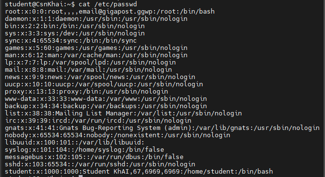

Файл /etc/group:

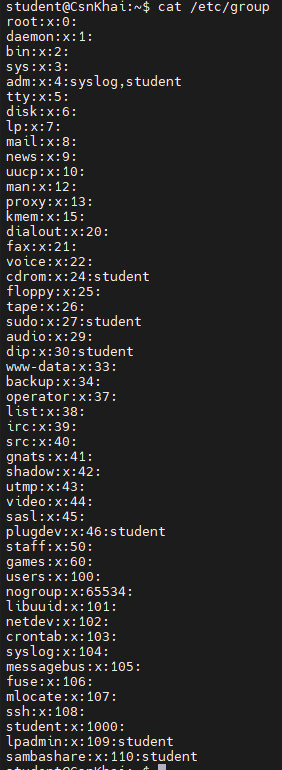

Файл /etc/passwd містить інформацію про облікові записи користувачів. Кожен рядок складається з сьоми полів, розділених двокрапками:

1) Ім'я користувача.
2) Місце збереження пароля.
3) Ідентифікатор користувача.
4) Ідентифікатор групи.
5) Коментар, опис користувача.
6) Домашній каталог.
7) Командна оболонка.

Файл /etc/group містить інформацію про групи та містить чотири поля:

1) Ім'я групи.
2) Пароль групи.
3) Ідентифікатор групи.
4) Список додаткових користувачів.

Псевдокористувачі - системні облікові записи, призначені для запуску служб і виконання системних задач. Наприклад: root, daemon, bin, nobody, www-data. Їх можна визначити за призначенням, UID, домашнім каталогом та оболонкою. Часто у них UID менше за 1000, а замість звичайної оболонки вказано, наприклад, /usr/sbin/nologin.

---

### 2) Які існують негласні діапазони UID? Що таке UID? Як його визначити?

UID - унікальний ідентифікатор користувача в Linux. Зазвичай він має такі діапазони:

0 - користувач root.\
1-999 - системні користувачі та служби.\
1000+ - звичайні користуачі.

Визначити UID можна за допомогою команди id -u:

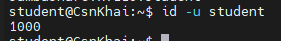

---

### 3) Що таке GID? Як його визначити?

GID - числовий ідентифікатор групи користувачів. Його можна отримати за допомогою комнди id -g:

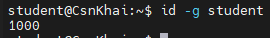

---

### 4) Як визначити, хто входить до якої групи?

Через файл /etc/groups:

Через команду groups:

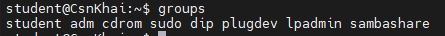

---

### 5) Які існують команди для додавання користувача до системи? Які основні параметри необхідні для створення користувача?

Для створення користувача існують команди useradd і adduser. Зазвичай потрібно задати ім'я користувача, домашній каталог, оболонку, групу та пароль.

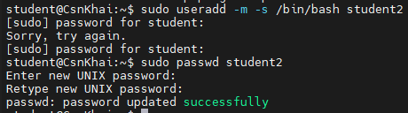

---

### 6) Як змінити ім'я (ім'я облікового запису) існуючого користувача?

Через команду usermod:

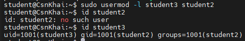

---

### 7) Що таке skel_dir? Яка його структура?

skel_dir - каталог, вміст якого копіюється при створенні нового користувача.

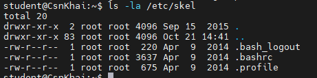

---

### 8) Як видалити користувача із системи (включаючи його поштову скриньку)?

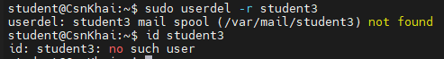

---

### 9) Які потрібно використовувати команди та ключі для блокування та розблокування облікового запису користувача?

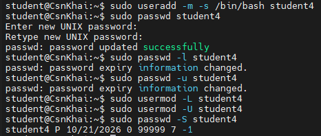

---

### 10) Як зняти пароль користувача та надати йому безпарольний вхід для подальшої зміни пароля?

Для видалення пароля:

Для нового пароля:

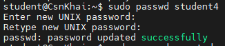

Для того, щоб користувач змінив пароль при наступному вході:

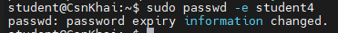

---

### 11) Вивести розширений формат інформації про каталог, розповісти про інформаційні стовпці, що виводяться на термінал.

Команда ls -l виводить розширену інформацію про каталоги й файли. ls -la показує ще й приховані файли.

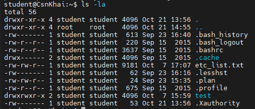

Перший стовпець - тип та права доступу.\
Другий стовпець - кількість жорстких посилань.\
Третій стовпець - власник.\
Четвертий стовпець - група.\
П'ятий стовпець - розмір.\
Шостий стовпець - дата/час зміни.\
Сьомий стовпець - сам файл.

---

### 12) Які права доступу існують і для когось (тобто описати основні ролі)? Опишіть коротко абревіатуру прав доступу.

Права доступу діляться на три категорії користувачів:
u - user, власник файлу.
g - group, користувачі основної групи файлу.
o - other, всі інші користувачі.

Основні права:
r - read, читати вміст.
w - write, змінювати вміст.
x - execute, запускати як програму.

---

### 13) Яка послідовність визначення відносин між файлом та користувачем?

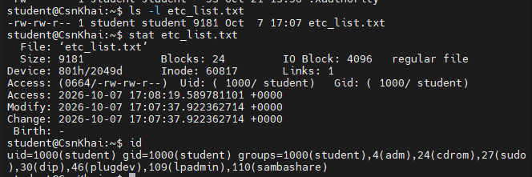

Якщо UID користувача збігається з UID власника файла, то даються права власника. Якщо ж збігається GID, то даються права групи. В інших випадках даються права для інших користувачів.

---

### 14) Які команди використовуються для зміни власника файлу (каталогу) та режиму доступу до файлу? Наведіть приклади, продемонструйте на терміналі.

Використовуються команди chown та chmod:

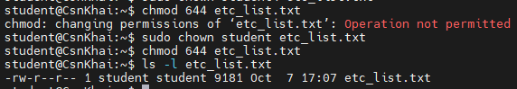

---

### 15) Наведіть приклад восьмеричного надання прав доступу. Опишіть umask.

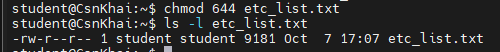

umask - маска, яка визначає, які права будуть виключені при створенні нових файлів та каталогів: 

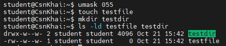

---

### 16) Дайте визначення sticky біт і механізму заміни ідентифікатора. Наведіть приклад файлів та каталогів із даними атрибутами.

Sticky bit для каталогів обмежує видалення й пере'менування файлів: користувач зазвичай може видалити або перейменувати тільки власні файли.

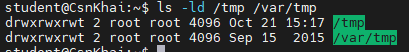

t в кінці означає sticky bit.

Механізм заміни ідентифікатора дозволяє файлу запускатися з привілеями власника файлу. Приклад файлу:

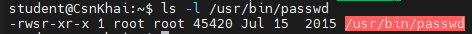

---

### 17) Які атрибути файлу повинні бути присутніми у командному скрипті?

1) Інтерпритатор - вказується в першому рядку.
2) Право на виконання - наприклад, через chmod.
3) Коректний вміст - команди повинні мати правильний синтаксис.
4) Доступ до файлу - користувач повинен мати право читання скрипту та проходу через батьківські каталоги.

---

### 18) Опишіть коротко роботу з механізмом квот, основні конфігураційні файли, принцип роботи, основні поняття.

Дискові квоти – це механізм обмеження обсягу дискового простору та кількості файлів, які користувач або група можуть використовувати у файловій системі. Квоти застосовуються для запобігання надмірному використанню диска одним користувачем або групою.

- Soft limit — м'яка межа, яка може бути тимчасово перевищена протягом встановленого періоду.
- Hard limit - жорстка межа, яку не можна перевищувати.
- Блоки (blocks) – одиниці обліку зайнятого дискового простору.
- Inodes - структури, що враховують кількість файлів та каталогів.
- Grace period – період, протягом якого дозволено тимчасове перевищення м'якої межі.

У класичній конфігурації квот використовуються файли /etc/fstab, /etc/quotas (у деяких системах) та файли обліку, такі як aquota.user та aquota.group. 